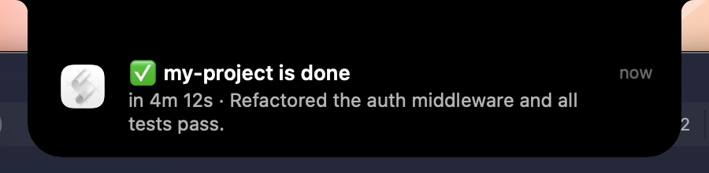

<div align="center">

# ✅ claude-done

**Stop alt-tabbing to check on Claude Code. Your Mac tells you when it's done, or when it needs you.**

[](https://github.com/abdiraimov-otabek/homebrew-tap)


[](LICENSE)

</div>

```
✅ halo is done                          ✋ halo needs you
in 4m 12s · Refactored the auth          Claude needs your permission to use Bash
middleware and all tests pass.
```

Claude Code's own alerts don't say **which project** is done, and nothing tells you **how long** it ran. claude-done adds both, plus a sound, and stays quiet for quick answers.

## Install

```sh
brew install abdiraimov-otabek/tap/claude-done
claude-done install
claude-done test
```

`install` adds four hooks to `~/.claude/settings.json`. It keeps a backup and leaves your own hooks alone. Running it twice doesn't add anything twice.

Without Homebrew:

```sh
curl -fsSL https://raw.githubusercontent.com/abdiraimov-otabek/claude-done/main/claude-done -o /usr/local/bin/claude-done
chmod +x /usr/local/bin/claude-done
claude-done install
```

It's one Bash script with no dependencies: it uses `plutil`, `osascript` and `afplay`, which ship with every Mac.

## What you get

| When | Notification | Sound |
|---|---|---|
| Claude Code finishes a turn that took 20 s or more | ✅ **project is done** · how long it took · the first line of its reply | Glass |
| It needs your permission | ✋ **project needs you** · what it's asking | Ping |
| It stops on an API error | ❌ **project stopped** | Basso |

Quick answers stay silent, and so does Claude Code's "waiting for your input" reminder, since you already got the ✅.

## Settings

Put any of these in `~/.config/claude-done/config`:

```sh
MIN_SECONDS=60       # only ping for turns longer than a minute
SOUND_DONE=Hero      # any sound in /System/Library/Sounds, or none
SOUND_ASK=none
NOTIFY_IDLE=1        # also ping when Claude has been waiting for your input
```

## Uninstall

```sh
claude-done uninstall
brew uninstall claude-done
```

`uninstall` removes only claude-done's hooks.

## Notes

- The first notification comes from **Script Editor**, macOS's sender for scripts. If you don't see it, allow Script Editor in System Settings › Notifications.
- Focus modes hide notifications as usual. The sound still plays unless you set it to `none`.
- Nothing leaves your Mac. The only file it writes is a start time per session in your temp folder.

## Want it in your notch instead?

I also make [Halo](https://halo-mac.com/?ref=claude-done), which shows every Claude Code and Codex session live in the MacBook notch: what each one is doing, which one needs you, and your usage limits. claude-done is the free, plain version of the same idea. With Halo running, even claude-done's alerts land in the notch:



## Test

```sh
./test.sh
```

Feeds sample hook input through the script and installs into a throwaway settings file. It never touches your real one.

MIT © [Otabek Abdiraimov](https://x.com/abdiraimov_)
